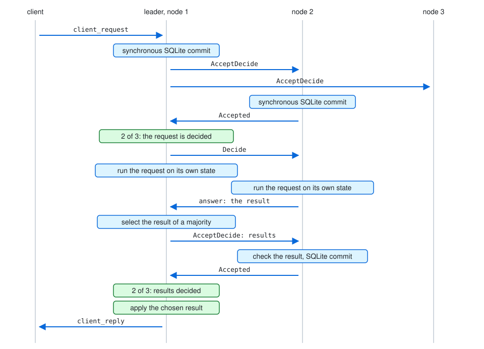
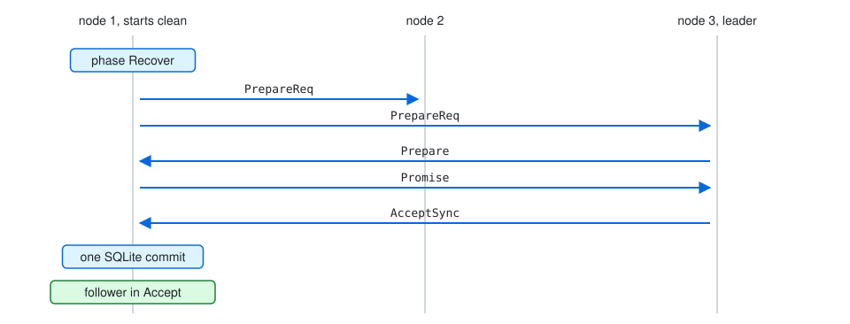

# mbedded-konsens

A C++ library that replicates a log over a cluster of nodes. A majority
of the nodes decides each entry, and an entry counts as decided only
after a majority wrote it to disk with a synchronous SQLite commit. Each
node applies the decided entries in order to a state machine that the
program gives.

```cpp
struct counter {
    static constexpr std::array key{std::byte{'c'}};

    static std::uint64_t value_in(const konsens::state_view auto& view)
    {
        const auto found = view.find(key);
        return found ? value_of(*found) : 0;
    }

    konsens::applied apply(std::span<const std::byte>, const konsens::state_view auto& view) const
    {
        auto next = bytes_of(value_in(view) + 1);
        return {next, {{{key.begin(), key.end()}, next}}};
    }

    std::vector<std::byte> query(std::span<const std::byte>, const konsens::state_view auto& view) const
    {
        return bytes_of(value_in(view));
    }
};

for (const auto* d : {"node-1", "node-1-node"})
    std::filesystem::create_directories(d);
auto storage = konsens::persistent_storage::open("node-1", max_size, geteuid()).value();
auto own_storage = konsens::node_storage::open("node-1-node", geteuid()).value();
auto node = konsens::node<konsens::persistent_storage, counter>::with(
    {.configuration_id = 1, .pid = 1, .peers = {2, 3}, .leader_priority = 0,
     .election_tick_timeout = 5, .resend_message_tick_timeout = 3, .first_start = true},
    std::move(storage), std::move(own_storage), counter{}, nonce).value();
```

It follows Omni-Paxos (Sequence Paxos and Ballot Leader Election), the
client table of Viewstamped Replication Revisited, and
the read index of the Raft dissertation. The messages between the nodes
are CBOR (RFC 8949). The checksum of each stored entry is CRC32C
(RFC 7143).

## Features

- **Durable decisions.** A node answers Accepted only after the
  synchronous commit of the entry.
- **Clean stop.** `stop()` writes a mark into the node storage. The
  next start reads the mark and deletes it. A node with a mark that
  agrees with its store votes again, and sends PrepareReq to its peers.
  The caller sets `first_start` for the first start of a node. Every
  other start retires the node: `retired()` returns true, and the node
  sends nothing and votes never. The operator replaces a retired node
  with a reconfiguration.
- **Linearizable reads.** A read goes through a read index: one round
  of heartbeats to a majority, and the answer comes from the applied
  state at that index.
- **Client sessions.** The state machine executes each request number
  of a session once. A request that comes again gets the kept reply.
- **Checksums.** Each log entry carries a CRC32C over its index and its
  bytes. Each meta value carries a CRC32C over its bytes.
- **Your network.** The node gives its outgoing messages to the
  program, and the program gives it the messages that arrive.
  `konsens::encode` and `konsens::decode` turn them into bytes.
- **Errors as values.** Each call returns `std::expected`. A wrong use
  stops with `std::logic_error`. A write to the disk that fails throws
  `konsens::write_error`, and a sync that fails throws
  `konsens::sync_error`. The messages and the replies of that commit
  stay in the node.
- **Group commit.** Each call collects its writes and its messages, and
  returns a `konsens::transaction`. `commit()` takes the transaction and
  writes all collected writes in one SQLite transaction, which SQLite
  syncs. Only the commit gives the messages and the replies to the
  program.
- **Execute-verify.** Every node runs every decided request on its own
  state and sends its result to the leader. The leader appends the
  result of a majority as a `results` entry. Each node checks that entry
  before it accepts it, and applies the chosen result when the entry is
  decided. When no result of a request can get a majority, the leader
  appends a `rejected` entry, and the request changes no state.
- **Floats.** A state machine with the fields `float_digits` and
  `float_denominator` gives its reply and each value as one encoded CBOR
  data item. The library rounds each float of the result to
  `float_denominator` digits with round half to even, before the CRC.
  Two results agree when each float agrees to `float_digits`
  significant digits or to one step of the denominator, and every other
  item agrees byte for byte.
- **A fault of the own node ends the node.** When a node finds a damage
  of its own log, a chosen result that fails its CRC on the node, a
  value that reads back different, or its own result outside the
  majority when the leader listed it, it writes a proof into the node
  storage and throws `konsens::node_fault`. The next start retires the
  node. A damage that the start finds retires the node too. A leader
  whose `results` entry a majority refused throws in the same way.
- **Runs on your thread.** Each call runs on the thread of the caller.
  `commit()` returns when its writes reach the file. The program makes
  the sync.

## How a write works



The leader commits the entry to its own disk and sends it to its
followers. When one more node has committed it, two of three nodes hold
it, and the leader decides it. The leader sends Decide to its
followers. Each node runs the decided request on its own state and
sends its result to the leader. The leader appends the result of a
majority as a `results` entry, and that entry is decided as every
entry. Each node then applies the chosen result, and the node that took
the request replies. So a write needs two rounds before its reply.

## How a node starts



A node that starts after a clean stop sends PrepareReq to every peer,
as the fail-recovery of Omni-Paxos does. The leader answers with
Prepare, the node answers with Promise, and the leader sends the
entries that the node misses in AcceptSync. A node that starts without
a matching clean-stop mark retires. It votes never again, and the
operator replaces it with a new node through a reconfiguration.

## Performance

Each part of a write, one at a time. Three nodes in one process, each
with its own store, each message through `encode` and
`decode`. In the serial form the nodes run one after the other; in the
threaded form each node runs on its own thread. g++ 16 `-O2`, x86-64, a
Firecracker VM with 4 cpus, ext4. ns or µs per operation, median of 7
rounds of 31 samples, payload 1 KiB:

| Operation | Time |
|---|---|
| CRC32C | 34 ns |

| Message | Encode | Decode | Handle |
|---|---|---|---|
| AcceptDecide, 64 × 1 KiB | 45 µs | 55 µs | 4.8 µs |
| Decide | 65 ns | 277 ns | 61 ns |

The largest difference between two builds of the same source is 30.3 %,
in the case of 64 writes of 64 KiB at once; in the cases of this table
it is 2.8 % or less.
All cases, the payloads of 64 B and 64 KiB and the context of the run:
[bench/results/2026-10-22-052032Z.txt](bench/results/2026-10-22-052032Z.txt).
`bench/run.sh` runs the bench; the option `-DKONSENS_BENCH=ON` builds it.
CRC32C of Google crc32c against a byte table:
[bench/results/2026-10-22-053257Z.txt](bench/results/2026-10-22-053257Z.txt).
The cost of the checksum against a MAC:
[bench/results/2026-10-21-092557Z.txt](bench/results/2026-10-21-092557Z.txt).

## Requirements

| Part | Version |
|---|---|
| Compiler | g++ 15 or later |
| System | Linux |
| SQLite | the package of the distribution, `libsqlite3-dev` |
| Boost | the headers |
| mbedded-cbor | fetched by CMake at the commit in `cmake/dependencies.cmake` |
| crc32c | the submodule `deps/crc32c`, Google crc32c, BSD-3-Clause license |
| doctest | for the tests |

The library runs as a user that is not root.

## Installation

Ubuntu 26.04:

```sh
sudo apt install g++-15 cmake doctest-dev libboost-dev libsqlite3-dev git
```

On openSUSE Tumbleweed, Boost comes from `libboost_headers-devel` and
SQLite from `sqlite3-devel`.

```sh
git clone https://github.com/Asmod4n/mbedded-konsens
cd mbedded-konsens
git submodule update --init --recursive
CC=gcc-15 CXX=g++-15 cmake -S . -B build -DCMAKE_BUILD_TYPE=Release
cmake --build build
```

The configure step fetches mbedded-cbor, and with `KONSENS_PROGRAM`
also slipstreamIO and mruby-webmachine, at the commits in
`cmake/dependencies.cmake`. `-DFETCHCONTENT_SOURCE_DIR_MBEDDED-CBOR=<dir>`
builds against a local tree of mbedded-cbor instead.

The library is the CMake target `konsens`.

## Usage

### Run a node

The program owns the clock and the network. On each tick of its clock,
it calls `tick()`. It gives the messages that arrived to
`handle_incoming()` as one batch. It adds the two transactions with
`+=`, commits them, and sends each outgoing message.

```cpp
auto t = node.tick().value();

// arrived: the bytes of each message from a peer since the last commit
std::vector<konsens::received> batch;
for (auto& bytes : arrived)
    batch.push_back(konsens::decode(std::move(bytes)).value());
t += node.handle_incoming(std::move(batch)).value();

node.commit(t).value();

for (const auto& m : node.take_outgoing_messages())
    send(konsens::encode(m).value());
```

Each call collects its writes and its messages and returns a
transaction. `commit()` writes the collected writes in one SQLite
transaction, and SQLite syncs it before `commit()` returns. The messages
of a step leave after that commit. `take_outgoing_messages()` and
`take_client_replies()` give what a commit released. The compiler refuses a transaction that the program
drops. A commit of a transaction that is committed, or of a transaction
of another node, throws `std::logic_error`. At most
`konsens::max_batch_size` messages wait for one commit.

Each `open` takes a directory that exists. Each storage takes a
directory of its own.

The nonce is a new random number for each start of the process.

At start, the program calls `konsens::can_use_crc32c_instruction()`.
When it gives false, the CPU has no CRC32C instruction, each CRC32C
runs without it and is slower, and the program writes a warning.

### Write through a session

```cpp
node.commit(node.register_client(client_id).value()).value();
// the reply of the registration carries the session
node.commit(node.client_request(client_id, session, 1, payload).value()).value();

for (const auto& r : node.take_client_replies())
    use(r.client_id, r.response);
```

Any node takes a call. A follower forwards it to the leader.

### Read

```cpp
node.commit(node.client_query(client_id, payload).value()).value();
```

The reply comes through `take_client_replies()` when the applied state
of the node reaches the read index.

### Error values

| Error value | Case |
|---|---|
| `building` | The node builds and takes no call. |
| `session_expired` | The session has expired. Register again. |
| `stale_request` | The request number is below the last request number of the session. |
| `retry` | The node knows no leader, or its promise changed. Send the call again. |
| `retired` | The node is retired. Send the call to another node. |
| `stopped` | The node stopped before the call was decided. The call may still be decided. |
| `rejected` | No result of the request got a majority. The request changed no state. |

## The program konsensd

`konsensd` runs one node of a cluster. It sends the messages of the
library to the other nodes over TCP, and serves clients over HTTP/1.1.
The CMake option `KONSENS_PROGRAM` builds it. It needs the packages
libtomlplusplus-dev and libada-url-dev.

### A cluster of three machines

Each machine runs one node in podman. Build the image on each machine:

```sh
git clone --recursive https://github.com/Asmod4n/mbedded-konsens
cd mbedded-konsens
podman build -f containers/konsensd/Containerfile --target run -t localhost/konsensd .
```

Write `/etc/konsensd/konsensd.toml` on each machine. The file
[containers/konsensd/konsensd.toml](containers/konsensd/konsensd.toml)
shows node 1 of three. Each node has its own `pid` and `peer_address`;
`[[peers]]` names the two other nodes.

| Key | Meaning | Default |
|---|---|---|
| `cluster.name` | The name of the cluster. A node refuses a peer with another name. | |
| `cluster.configuration_id` | The number of the configuration. | |
| `node.pid` | The number of this node. | |
| `node.data_directory` | The directory of the store. | |
| `node.peer_address` | The address where the other nodes connect. | |
| `node.client_address` | The address where the clients connect. | |
| `node.leader_priority` | Of two ballots in the same round, the node with the higher value wins. | 0 |
| `node.election_ticks` | Ticks without a heartbeat before an election. | 5 |
| `node.resend_ticks` | Ticks before a message is sent again. | 3 |
| `node.tick_milliseconds` | The length of a tick. | 100 |
| `node.max_frame_bytes` | The largest message between nodes. | 1 GiB |
| `node.max_body_bytes` | The largest value of a client. | 1 MiB |
| `node.max_store_bytes` | The largest store. | 64 GiB |
| `peers.pid`, `peers.address` | Another node of the cluster. | |

Start each node once with `--first-start`, on all three machines. Stop
it with Ctrl-C when the three nodes have elected a leader:

```sh
podman run --rm -it --network host -v konsensd-data:/var/lib/konsensd \
    -v /etc/konsensd/konsensd.toml:/etc/konsensd/konsensd.toml:ro \
    localhost/konsensd --config /etc/konsensd/konsensd.toml --first-start
```

On macOS, `-p 7151:7151 -p 7161:7161` takes the place of
`--network host`, and the config comes from
`~/.config/konsensd/konsensd.toml`.

Then a service runs the node. The form depends on the system.

Linux with podman 4.4 or later (for example openSUSE Tumbleweed,
Raspberry Pi OS 13): copy the quadlet unit
[containers/konsensd/konsensd.container](containers/konsensd/konsensd.container)
to `/etc/containers/systemd/`, and start it:

```sh
sudo systemctl daemon-reload
sudo systemctl start konsensd
```

Linux with an older podman (for example Raspberry Pi OS 12): copy
[containers/konsensd/konsensd.service](containers/konsensd/konsensd.service)
to `/etc/systemd/system/`, then `sudo systemctl enable --now konsensd`.

macOS: podman runs the image in its Linux machine
(`podman machine init`, then `podman machine start`). The machine has
its own network, so the node publishes its ports instead of using the
host network. Copy
[containers/konsensd/macos/konsensd.sh](containers/konsensd/macos/konsensd.sh)
to `/usr/local/libexec/`, the config to
`~/.config/konsensd/konsensd.toml`, and
[the launchd agent](containers/konsensd/macos/io.github.asmod4n.konsensd.plist)
to `~/Library/LaunchAgents/`, then
`launchctl load ~/Library/LaunchAgents/io.github.asmod4n.konsensd.plist`.
The agent sends SIGTERM to the node when launchd stops it.

The image for arm64 (Mac mini, Raspberry Pi) builds on any arm64
machine. One build is enough for both:

```sh
podman save localhost/konsensd | ssh pi podman load
```

`systemctl stop` and a shutdown send SIGTERM. The node then stops
cleanly and keeps its vote. A node that ends without a clean stop
(SIGKILL, a crash, a loss of power) starts retired: it answers 503 and
takes no part in the cluster. The other two nodes serve the clients.

### Clients

Any node takes any call. A follower sends a write to the leader.

```sh
curl -X PUT --data-binary 'hello' http://node1:7161/kv/greeting
curl http://node2:7161/kv/greeting
curl -X DELETE http://node3:7161/kv/greeting
```

The key is percent-encoded in the path. A value is bytes.

| Status | Case |
|---|---|
| 200 | The value of the key. |
| 204 | The write or the delete is decided. |
| 400 | The request does not parse. |
| 404 | The key is not there, or the path is not `/kv/` and one key. |
| 405 | The method is not GET, PUT or DELETE. |
| 409 | The cluster rejected the write. |
| 411 | A PUT without Content-Length. |
| 413 | The value is larger than `max_body_bytes`. |
| 503 with Retry-After | The node knows no leader, builds, changes its configuration or is retired. Send the call again. |
| 503 without Retry-After | The node stopped. The write may still be decided. |

An error comes as problem details of RFC 9457
(`application/problem+json`). Each connection is one client session:
a write waits until it is decided before the next request of the same
connection is read.

## Documentation

- [doc/](doc/): the plan of each part of the library and its review.
- [model/plan.md](model/plan.md): the TLA+ model, its properties and faults.
- [model/results/](model/results/): one file for each run of the model checker.
- [refs/](refs/): the specifications and papers that the code follows.

## Testing

The unit tests cover each message of Sequence Paxos and Ballot Leader
Election, the SQLite store, the wire form and the clients. `test_simulation`,
`test_simulation_rollback` and `test_simulation_clients` run three nodes
on SQLite for 2000 seeds with message loss, duplicate messages, a crash
and a restart from an earlier copy of the store. They check the safety
properties of the model after each step.
`counter_stress` runs many clients against three nodes on a network
that loses and repeats messages. The tests run with g++ 15 and g++ 16, with
AddressSanitizer and UndefinedBehaviorSanitizer.

The tests open their stores in `TMPDIR`. The cache variable
`KONSENS_TEST_TMPDIR` sets `TMPDIR` for each test, for example to a
tmpfs:

```sh
cmake -S . -B build -DKONSENS_TEST_TMPDIR=/dev/shm
```

All tests pass with a tmpfs of 64 MiB. A build with AddressSanitizer runs
200 seeds of each simulation instead of 2000.

`test_device_faults` runs SQLite on a FUSE file system that fails each
fsync, each write of the database file and its WAL, or the reads of one
range of the database file. A storage and a cluster of three nodes run on it. It needs the packages
libfuse3-dev and fuse3, the device /dev/fuse and the right to mount. The
option turns it on:

```sh
cmake -S . -B build -DKONSENS_FUSE_TESTS=ON
```

In podman, the container needs `--device /dev/fuse --cap-add SYS_ADMIN`.

The TLA+ model of the protocol is checked with TLC for each fault: lost
and duplicate messages, crashes, a disk that loses writes, and a
restart of every node.

## Status

Version 0.0.1, before the first release. The API and the wire form can
still change.

## License

Apache License 2.0. See [LICENSE](LICENSE).
